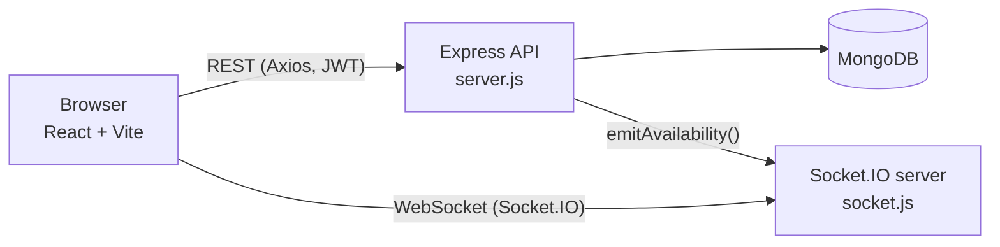
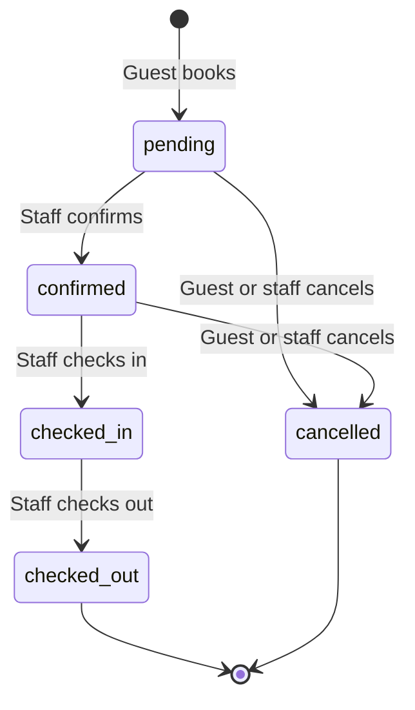

# 3. Architecture

## System overview



The browser talks to one Node process that hosts both the REST API and the Socket.IO server on the same HTTP server and port.

## Backend

### Startup (`server.js`)

1. Load environment variables with `dotenv`.
2. Register global middleware: `helmet`, `cors` (restricted to `CLIENT_URL`), `express.json`, `morgan('dev')`.
3. Mount routers: `/api/auth`, `/api/rooms`, `/api/bookings`, plus `GET /api/health`.
4. Add a 404 handler and a central error handler.
5. Connect to MongoDB. Only after the connection succeeds, create the HTTP server, attach Socket.IO, and listen. If the connection fails, the process exits with code 1.

### Error handling

The central error handler converts common errors into clean JSON responses of the form `{ "message": "..." }`:

| Error | HTTP status | Message |
|-------|-------------|---------|
| Mongoose `ValidationError` | 400 | The validation message |
| Mongoose `CastError` (bad ObjectId) | 400 | `Invalid id` |
| Duplicate key (code 11000) | 400 | `Duplicate value: <field>` |
| Unmatched route | 404 | `Not found: <url>` |
| Anything else | 500 | The error message |

### Middleware (`middleware/auth.js`)

- `protect` reads the `Authorization: Bearer <token>` header, verifies the JWT, loads the user from the database and attaches it as `req.user`. It returns 401 if the token is missing, invalid or expired, or if the user no longer exists.
- `authorize(...roles)` returns 403 unless `req.user.role` is in the allowed list. It must run after `protect`.

### Availability logic (`utils/availability.js`)

A booking **blocks** a room when its status is `pending`, `confirmed` or `checked-in`. Cancelled and checked-out bookings do not block.

Two stays overlap when the existing stay starts before the new one ends **and** ends after the new one starts:

```
existing.checkIn  < new.checkOut
existing.checkOut > new.checkIn
```

So a guest can check in on the same day another guest checks out (back-to-back stays are allowed).

| Helper | Purpose |
|--------|---------|
| `overlapQuery(roomId, checkIn, checkOut)` | Builds the Mongo filter above |
| `findConflicts(...)` | Returns clashing date ranges only (no guest details) |
| `isRoomFree(...)` | Boolean check, optionally ignoring one booking (used when editing) |
| `getBookedRanges(roomId)` | Upcoming blocked ranges for display |

### Double-booking protection

Creating a booking (`POST /api/bookings`) works in three steps:

1. `isRoomFree` check. If the room is taken, return **409**.
2. Create the booking.
3. **Race guard:** look for another active booking on the same dates with a *lower* `_id`. If one exists, delete the new booking and return **409**. If two guests submit at the same instant, exactly one wins, because the one with the lower `_id` always survives.

## Frontend

### Component tree

```
main.jsx
└── BrowserRouter
    └── AuthProvider
        └── App
            ├── Navbar
            └── Routes
                ├── /               RoomList
                ├── /login          Login
                ├── /register       Register
                ├── /book/:roomId   ProtectedRoute → BookingForm
                └── /dashboard      ProtectedRoute → Dashboard
```

### State and data flow

| Concern | Where it lives |
|---------|----------------|
| Signed-in user and token | `AuthContext`, persisted in `localStorage` under the key `hotelpro_user` |
| HTTP calls | `services/api.js`, an Axios instance whose request interceptor adds the `Authorization` header |
| Error messages | `getError(err)` returns the server's `message` when available |
| Live availability | `hooks/useAvailability.js` combines debounced REST checks with socket events |
| Socket connection | `services/socket.js`, one shared client, URL derived from `VITE_API_URL` |

### Route protection

`ProtectedRoute` redirects unauthenticated users to `/login` and remembers the page they wanted. It also accepts an optional `roles` prop that redirects users with the wrong role to `/`. Client-side checks are only for convenience. The server enforces every permission.

## Booking life cycle



Side effects:

| Transition | Effect |
|------------|--------|
| → `checked-in` | Room status becomes `occupied` |
| → `checked-out` | Room status becomes `available` |
| → `cancelled` | If `paymentStatus` was `paid`, it becomes `refunded` |
| Create, cancel, or change dates | Socket event tells watchers availability changed |
