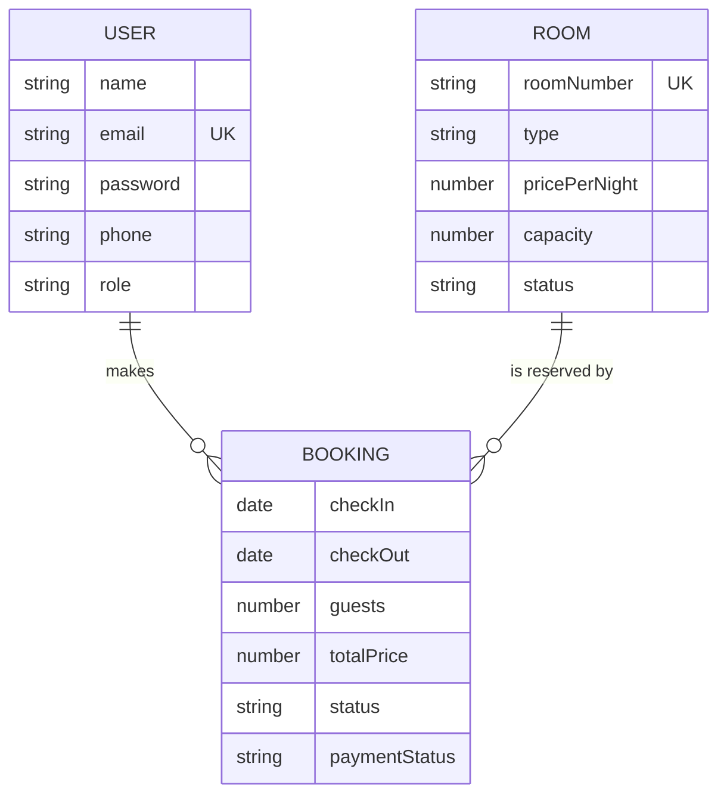

# 4. Database

HotelPro uses MongoDB through Mongoose. There are three collections. All schemas use `timestamps: true`, so each document also has `createdAt` and `updatedAt`.

## User

| Field | Type | Rules |
|-------|------|-------|
| `name` | String | Required, trimmed |
| `email` | String | Required, **unique**, lowercased, trimmed |
| `password` | String | Required, min length 6, **hidden from queries by default** (`select: false`) |
| `phone` | String | Optional, trimmed |
| `role` | String | `guest` (default), `staff` or `admin` |

- A `pre('save')` hook hashes the password with bcrypt (10 salt rounds) whenever it changes.
- `user.matchPassword(plain)` compares a plain password to the stored hash.
- Login uses `.select('+password')` to read the hash explicitly.

## Room

| Field | Type | Rules |
|-------|------|-------|
| `roomNumber` | String | Required, **unique**, trimmed |
| `type` | String | `single`, `double`, `deluxe` or `suite` |
| `pricePerNight` | Number | Required, min 0 (rupees) |
| `capacity` | Number | Required, min 1 |
| `amenities` | [String] | e.g. WiFi, AC, TV |
| `images` | [String] | Image URLs. Stored but not yet shown in the UI. |
| `description` | String | Free text |
| `status` | String | `available` (default), `occupied` or `maintenance` |

Index: `{ type: 1, pricePerNight: 1 }` for filtered searches.

Rooms in `maintenance` are hidden from search results and cannot be booked.

## Booking

| Field | Type | Rules |
|-------|------|-------|
| `user` | ObjectId → User | Required |
| `room` | ObjectId → Room | Required |
| `checkIn` | Date | Required |
| `checkOut` | Date | Required |
| `guests` | Number | Required, min 1 |
| `totalPrice` | Number | Required. Calculated by the server as `nights × pricePerNight`. |
| `status` | String | `pending` (default), `confirmed`, `checked-in`, `checked-out`, `cancelled` |
| `paymentStatus` | String | `unpaid` (default), `paid`, `refunded` |

Index: `{ room: 1, checkIn: 1, checkOut: 1 }`, which speeds up the overlap check.

`totalPrice` is stored at booking time and recalculated if dates change. A later change to a room's price does not alter existing bookings.

## Seed data

`npm run seed` deletes all users and rooms, then inserts 3 demo users and 12 rooms (see [02-setup.md](02-setup.md#demo-accounts)). It does **not** delete bookings, so old bookings can reference rooms that no longer exist. The dashboard shows such rooms as "Removed".
