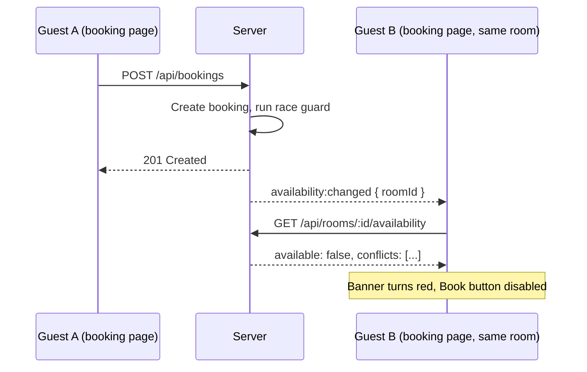

# 6. Real-Time Updates

HotelPro uses Socket.IO so that availability stays current without refreshing the page. If one guest books a room while another is looking at it, the second guest's screen updates within moments.

## Design principle

The server **never sends booking data over the socket**. It only announces that something changed, including the room id. Clients then re-fetch through the normal REST API. This keeps the socket simple and avoids leaking guest details to anonymous visitors.

## Events

| Event | Direction | Payload | Meaning |
|-------|-----------|---------|---------|
| `room:watch` | client → server | `roomId` | Join the channel `room:<roomId>` |
| `room:unwatch` | client → server | `roomId` | Leave that channel |
| `availability:changed` | server → clients watching that room | `{ roomId }` | Availability for this room changed. Re-check it. |
| `rooms:changed` | server → **all** clients | none | Some room's availability changed. Refresh the room list. |

## When the server emits

`emitAvailability(roomId)` (in `server/socket.js`) fires after:

- a booking is created (`POST /api/bookings`)
- a booking is cancelled or its dates or guest count are changed (`PUT /api/bookings/:id`)

It does **not** fire on check-in or check-out, because those do not change which dates are blocked.

## Client behaviour

**Booking page (`useAvailability` hook)**

1. Sends `room:watch` for the current room on mount and `room:unwatch` on unmount.
2. Re-checks availability when the selected dates change, debounced by 350 ms.
3. Re-checks when `availability:changed` arrives for that room.
4. Re-checks after the socket reconnects, to catch updates missed while offline.
5. Ignores out-of-date responses, so a slow earlier request can never overwrite a newer result.

**Room list (`RoomList`)**

Listens for `rooms:changed` and silently re-runs the current search, without showing a loading spinner.

## Flow example

## Connection details

- The socket URL is `VITE_API_URL` with the trailing `/api` removed.
- Transports: WebSocket first, with long-polling as a fallback.
- CORS for Socket.IO uses the same `CLIENT_URL` as the REST API.
