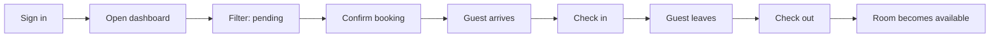

# Customer Journey Map

**Project:** HotelPro: Hotel Management Web Application
**Phase:** Requirement Analysis
**Persona:** The Guest (see [Empathy Map Canvas](../Ideation%20Phase-(1)/Empathy%20Map%20Canvas.md))

## Journey stages

| Stage | Discover and search | Check availability | Book | Wait for confirmation | Stay | Check-out and after |
|-------|--------------------|--------------------|------|-----------------------|------|---------------------|
| **Guest actions** | Opens the site, enters dates, guests, type and budget | Picks a room and tries dates | Confirms dates and guest count, submits | Checks "My bookings" | Staff checks them in | Staff checks them out |
| **Touchpoints** | Home page room search | Booking page availability banner | Booking form | Dashboard (My bookings) | Front desk | Front desk, dashboard |
| **Thinking** | "Which rooms suit me?" | "Is it free on my dates?" | "Is the price right?" | "Is it confirmed yet?" | "Is my room ready?" | "Was everything recorded?" |
| **Feeling** | Curious | Cautious, then relieved | Confident | Slightly anxious | Welcomed | Satisfied |
| **Pain points** | Too many options, unclear price | Fear of double booking | Fear of hidden costs | No news after booking | Waiting at the desk | No record of the stay |
| **HotelPro feature** | Filters for dates, guests, type, max price | Live check plus "Already booked" list | Total price shown and calculated by server | Status badge: pending → confirmed | One-click check-in by staff | One-click check-out by staff |

## Opportunities

| Opportunity | Status |
|-------------|--------|
| Show room photos in search results | Planned (images are stored, not yet displayed) |
| Send an email when the booking is confirmed | Planned |
| Online payment at booking time | Planned |
| Let guests change dates from the dashboard | Planned (API ready, screen not built) |
| Ratings and reviews after the stay | Future |

## Journey for the front-desk staff

