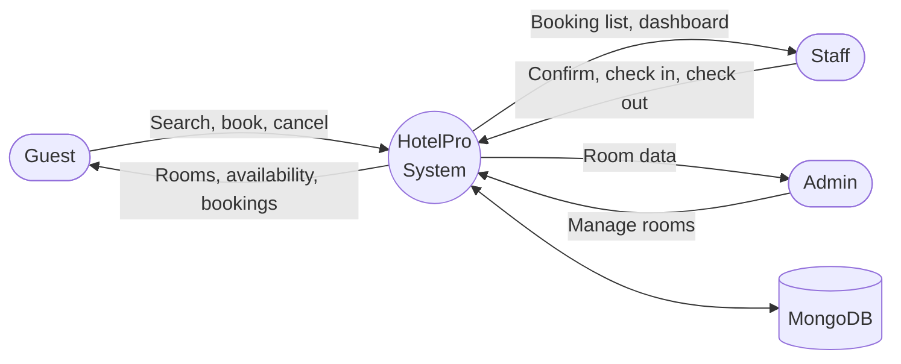
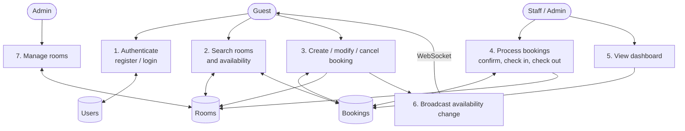

# Data Flow Diagram and User Stories

**Project:** HotelPro: Hotel Management Web Application
**Phase:** Requirement Analysis

## Data flow diagram: Level 0 (context)

## Data flow diagram: Level 1

| Process | Description |
|---------|-------------|
| 1. Authenticate | Validates credentials against Users, returns a signed token |
| 2. Search rooms | Reads Rooms and active Bookings to return only free rooms and booked ranges |
| 3. Booking changes | Validates dates and capacity, checks overlap, calculates price, saves to Bookings |
| 4. Process bookings | Moves a booking through confirmed → checked-in → checked-out and updates Room status |
| 5. Dashboard | Reads all Bookings with user and room details |
| 6. Broadcast | Sends "availability changed" signals to watching clients |
| 7. Manage rooms | Admin creates, edits and deletes Rooms |

## User stories

| Type | USN | User story | Acceptance criteria | Priority | Release |
|------|-----|-----------|---------------------|----------|---------|
| Guest | USN-1 | As a guest, I can register with my email and password so I can book rooms | Account is created, I am signed in, duplicate emails are rejected | High | Sprint-1 |
| Guest | USN-2 | As a guest, I can sign in and out | Valid credentials give access, invalid ones show an error | High | Sprint-1 |
| Guest | USN-3 | As a guest, I can search rooms by dates, guests, type and price | Only matching, free rooms are listed | High | Sprint-1 |
| Guest | USN-4 | As a guest, I can see if a room is free for my dates | A banner shows available or not, with clashing dates | High | Sprint-2 |
| Guest | USN-5 | As a guest, I can book a room and see the total price | Booking is created as pending with the correct total | High | Sprint-2 |
| Guest | USN-6 | As a guest, I can view and cancel my bookings | My bookings list shows status and a cancel button for pending or confirmed bookings | High | Sprint-3 |
| Guest | USN-7 | As a guest, I see availability update without refreshing | The banner and room list refresh when another user books | Medium | Sprint-3 |
| Staff | USN-8 | As staff, I can see all bookings and filter by status | Table lists every booking with guest details and counts | High | Sprint-3 |
| Staff | USN-9 | As staff, I can confirm a pending booking | Status changes to confirmed | High | Sprint-3 |
| Staff | USN-10 | As staff, I can check a guest in and out | Only confirmed bookings can be checked in, room status updates | High | Sprint-3 |
| Admin | USN-11 | As an admin, I can add, edit, delete rooms and set maintenance | Changes are saved and reflected in search | Medium | Sprint-2 (API) |
| Any | USN-12 | As a user, I get a clean, responsive, colourful interface | Layout works on mobile, theme applied consistently | Medium | Sprint-4 |
| Admin | USN-13 | As an admin, I can manage rooms from a screen | Admin UI for rooms | Medium | Next release |
| Guest | USN-14 | As a guest, I can pay online | Payment completes and booking shows paid | High | Next release |
