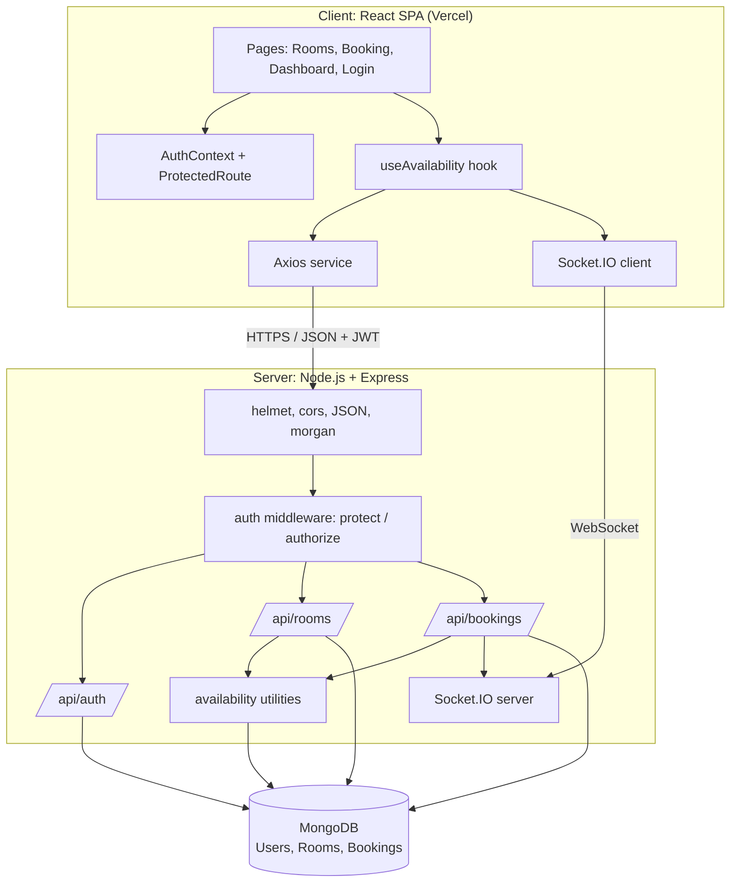
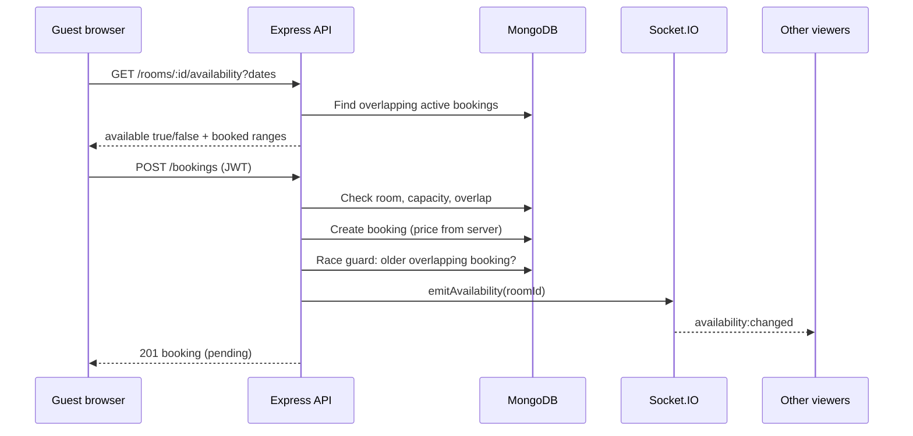

# Solution Architecture

**Project:** HotelPro: Hotel Management Web Application
**Phase:** Project Design

## Goals

- Bridge the business problem (double bookings, no live availability) and the technical solution.
- Describe structure, components, data flow and deployment.
- Provide a reference for developers, testers and evaluators.

## Architecture diagram

## Layers and responsibilities

| Layer | Responsibility | Key files |
|-------|----------------|-----------|
| Presentation | Pages, forms, routing, theme | `client/src/components`, `theme.css` |
| Client state and services | Login state, API calls, sockets, availability logic | `AuthContext.jsx`, `services/`, `hooks/useAvailability.js` |
| API | Routing, validation, business rules, error handling | `server/routes`, `server/server.js` |
| Security | JWT verification, role checks | `server/middleware/auth.js` |
| Domain logic | Overlap detection and availability | `server/utils/availability.js` |
| Real time | Rooms and watchers, availability events | `server/socket.js` |
| Data | Schemas, indexes, hashing hooks | `server/models` |

## Key flow: booking a room

## Deployment view

| Part | Where | Notes |
|------|-------|-------|
| Frontend (static build) | Vercel | `vercel.json` rewrites all paths to `index.html` for client-side routing |
| Backend (Node process) | Any host that keeps a process running | Must support WebSockets |
| Database | MongoDB Atlas or self-hosted MongoDB | Connection string in `MONGO_URI` |
| Configuration | Environment variables | `JWT_SECRET`, `CLIENT_URL`, `VITE_API_URL` and others |

## Design decisions

| Decision | Reason |
|----------|--------|
| Stateless JWT instead of server sessions | Simple and scalable |
| Server calculates price | Prevents tampering |
| Sockets send ids only | Avoids leaking guest data |
| Availability computed from date overlap, not from a stored flag | Always correct even when bookings change or cancel |
| Mongoose indexes on `{room, checkIn, checkOut}` | Fast overlap queries |

More detail: [Technical Documentation](../Technical%20Documentation/README.md).
