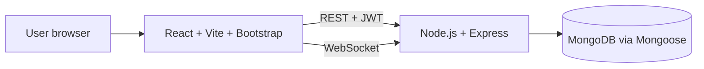

# Technology Stack

**Project:** HotelPro: Hotel Management Web Application
**Phase:** Requirement Analysis

## Architecture at a glance

## Components and technologies

| S.No | Component | Description | Technology |
|------|-----------|-------------|------------|
| 1 | User interface | Single-page app: search, booking, dashboard | React 18, React Router 6, Bootstrap 5, custom CSS theme |
| 2 | Build tool | Fast dev server and production bundling | Vite 5 |
| 3 | HTTP client | API calls with automatic token header | Axios |
| 4 | Application server | REST API, business rules, role checks | Node.js, Express 4 |
| 5 | Real-time layer | Availability change notifications | Socket.IO 4 (server and client) |
| 6 | Database | Users, rooms, bookings | MongoDB with Mongoose 8 |
| 7 | Authentication | Stateless sessions | JSON Web Tokens (jsonwebtoken) |
| 8 | Password security | One-way hashing | bcryptjs |
| 9 | Hardening and logging | Security headers, CORS, request logs | helmet, cors, morgan |
| 10 | Configuration | Per-environment settings | dotenv |
| 11 | Dev tooling | Auto-restart during development | nodemon |
| 12 | Hosting (frontend) | Static hosting with SPA rewrite | Vercel |
| 13 | Source control | Version history and collaboration | Git, GitHub |

## Application characteristics

| S.No | Characteristic | Detail | Technology |
|------|----------------|--------|------------|
| 1 | Open-source frameworks | The whole stack is open source | React, Express, MongoDB, Socket.IO, Bootstrap |
| 2 | Security implementations | Hashing, JWT, role guards, headers, CORS | bcryptjs, jsonwebtoken, helmet, cors |
| 3 | Scalable architecture | Stateless API, separate client and server | Express, JWT |
| 4 | Availability | Overlap queries backed by indexes | MongoDB indexes |
| 5 | Performance | Debounced checks, paginated listing, indexes | React hooks, Mongoose |

## Why these choices

- **React and Vite:** component reuse, fast feedback during development, large ecosystem.
- **Express and MongoDB:** the same language (JavaScript) end to end, flexible documents for rooms and amenities.
- **JWT:** no server-side session store, which keeps the API simple and horizontally scalable.
- **Socket.IO:** reliable real-time with automatic fallback to long-polling.
- **Bootstrap:** responsive layout and accessible components out of the box.
